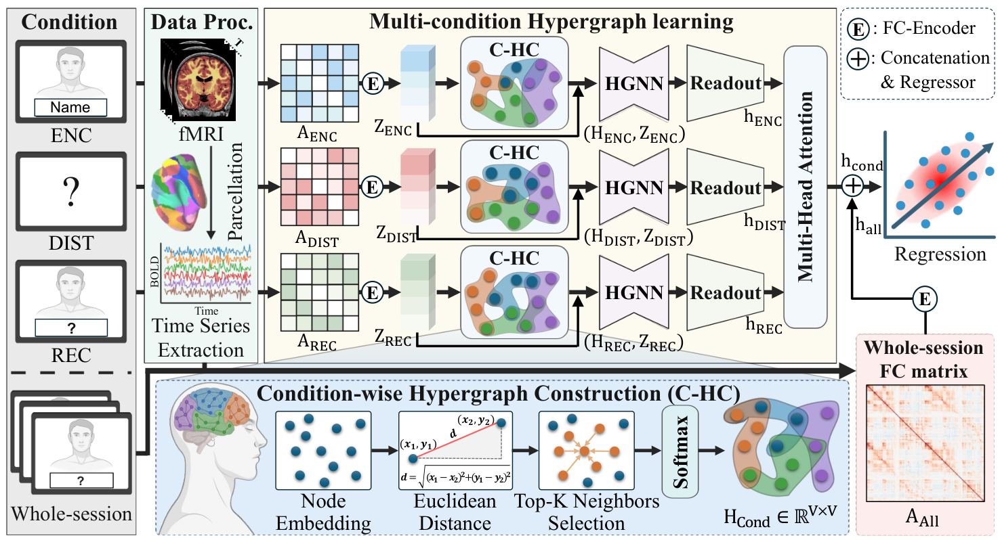

<div align="center">

# CoHyFuse

### Condition-wise Hypergraph Fusion with<br>Global Connectome in Task-fMRI

**Boseong Kim · Haejun Chung · Ikbeom Jang**

Hanyang University · Hankuk University of Foreign Studies

**IEEE BIBM 2026**

[](#quick-start)
[](#quick-start)
[](LICENSE)

[Overview](#overview) · [Quick start](#quick-start) · [Results](#results) · [Documentation](#documentation) · [Citation](#citation)

</div>

<p align="center">
  
</p>

<p align="center"><em>Condition-wise ROI neighborhoods and whole-session connectivity for task-fMRI prediction.</em></p>

## Overview

CoHyFuse represents task conditions with ROI-centered hypergraphs and combines
their embeddings with a whole-session functional connectivity (FC) representation.

- **Condition-wise hypergraphs.** A shared FC-profile encoder builds top-K neighborhoods with learned membership weights for each condition.
- **Attention fusion.** Shared HGNN encoding and ROI attention pooling produce condition tokens, which are fused by multi-head attention.
- **Whole-session connectivity.** An FC-vector branch complements the condition representation for regression or classification.

## Quick start

Use Python 3.10 or newer. Install a [PyTorch build](https://pytorch.org/get-started/locally/)
for your CPU or CUDA environment, then install CoHyFuse:

```bash
git clone https://github.com/labhai/CoHyFuse.git
cd CoHyFuse
python -m venv .venv
source .venv/bin/activate
python -m pip install -e '.[test]'
```

Check the model and training pipeline on synthetic inputs:

```bash
python -m pytest -q
```

The tests run on CPU without cohort data. Synthetic tests check execution;
they do not reproduce the manuscript's benchmark results.

## Results

The manuscript reports the following mean ± standard deviation across five folds.
These values have not been reproduced with this release.

| Task | Target | MAE ↓ | RMSE ↓ | R² ↑ |
|:--|:--|--:|--:|--:|
| FACENAME | Fluid Cognition Composite | 7.83 ± 0.10 | 9.91 ± 0.25 | 0.439 ± 0.026 |
| VISMOTOR | Age | 7.52 ± 0.37 | 9.61 ± 0.36 | 0.592 ± 0.022 |

For three-class ADHD classification on CMI-HBN, the manuscript reports
72.0 ± 2.1% macro-AUC and 74.2 ± 2.9% accuracy.

## Train and evaluate

Prepare a tensor dataset using the [data guide](docs/data.md), then run:

```bash
CUDA_VISIBLE_DEVICES=0 python train.py \
  --config configs/facename.json \
  --data data/facename.pt \
  --output outputs/facename \
  --device cuda:0
```

The FACENAME configuration uses ENC/DIST/REC order and predicts FCC.
Five subject-wise folds use approximately 64/16/20 train/validation/test splits.
Each fold selects hyperparameters and a checkpoint using validation loss, then
evaluates the selected model on the test set.

The default search evaluates 3,000 candidates per fold. Use `--fixed-k` to keep
the configured neighborhood sizes or `--device cpu` for CPU execution.
See the [training guide](docs/training.md) for saved folds and output files.

## Documentation

| Guide | Contents |
|:--|:--|
| [Data preparation](docs/data.md) | FC inputs, condition order and subject identifiers |
| [Training and evaluation](docs/training.md) | Configuration, model selection and outputs |

### Repository structure

| Path | Purpose |
|:--|:--|
| [`assets/`](assets/) | Architecture figure from the manuscript |
| [`cohyfuse/model.py`](cohyfuse/model.py) | Hypergraphs, HGNN encoding and dual-branch prediction |
| [`cohyfuse/data.py`](cohyfuse/data.py) | FC preparation, dataset loading and subject-wise splits |
| [`configs/facename.json`](configs/facename.json) | FACENAME model and training settings |
| [`train.py`](train.py) | Cross-validation, checkpoint selection and test evaluation |
| [`tests/`](tests/) | Model and training pipeline checks |

## Data access and license

This release provides source code under the [MIT License](LICENSE).
Cohort construction, reference splits, participant data and pretrained weights
are not included.

## Citation

```bibtex
@article{kim2026cohyfuse,
  title={CoHyFuse: Condition-wise Hypergraph Fusion with Global Connectome in Task-fMRI},
  author={Kim, Boseong and Chung, Haejun and Jang, Ikbeom},
  journal={arXiv preprint arXiv:2610.05913},
  year={2026}
}
```

## Contact

For code or research inquiries, contact [Boseong Kim](mailto:boseong@hanyang.ac.kr).
